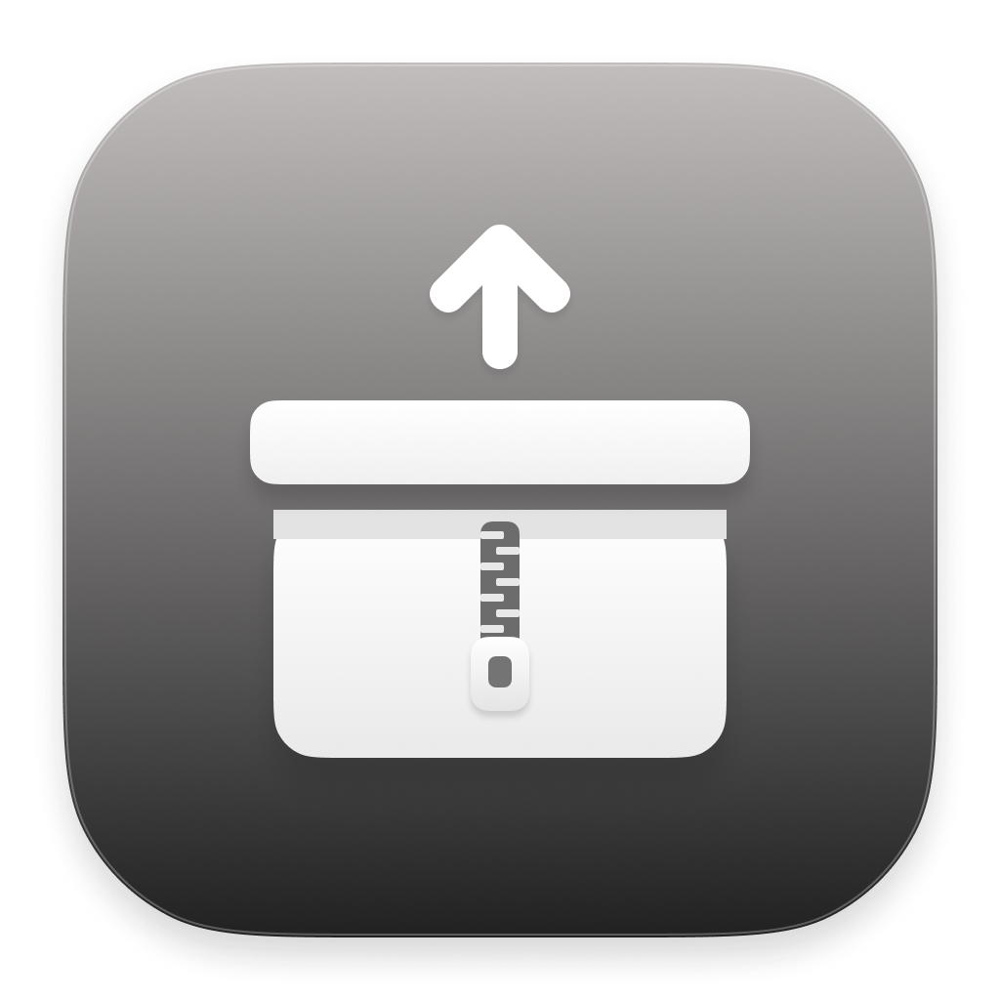

# RarToZip

<p align="center">
  
</p>

<p align="center">
  <b>App macOS 100% Swift</b> — giải nén RAR nhanh & chuyển RAR → ZIP. Tối giản, nhẹ, nhanh.
</p>

<p align="center">
  
  
  
</p>

> A minimal, fast, 100% Swift macOS app that extracts all RAR versions and converts them to ZIP.

---

## Tính năng

- **Double-click file `.rar`** → giải nén ngay tại thư mục chứa file (giống hành vi native của macOS).
- **Mở app** → cửa sổ pre-setup: chọn file RAR, thư mục đích, tên file, và chọn **Convert sang ZIP** hoặc **Giải nén**.
- **Kéo-thả** file `.rar` / `.cbr` vào cửa sổ để điền nhanh.
- **Convert RAR → ZIP** với 2 mức nén:
  - **Nhanh** (store) — không nén lại nội dung vốn đã nén sẵn → nhanh nhất.
  - **Nhỏ** (deflate) — ZIP nhỏ hơn, chậm hơn một chút.
- **Engine 2 tầng:** `unrar` (RARLAB — nhanh) là chính, `unar` fallback khi gặp file lạ.
- Hỗ trợ **RAR mọi phiên bản** (RAR1–RAR5), **RAR có mật khẩu**, **multi-volume** (`.part1.rar`, `.r00`, …).
- **Services menu** (chuột phải → Services → RarToZip): Convert / Extract.
- Chạy nền, thông báo qua Notification Center.
- App icon riêng, DMG cài đặt có background + icon sắp xếp.

## Yêu cầu

- **macOS 15.0** trở lên.
- Bản phát hành build sẵn là **arm64 (Apple Silicon)**. Trên Intel, cần build lại `unrar` / `unar` cho x86_64.
- **Không cần Xcode** — chỉ cần Command Line Tools (`xcode-select --install`).

## Cài đặt

### Cách 1 — Tải bản phát hành (khuyến nghị)

1. Vào tab **[Releases](../../releases)** và tải `RarToZip.dmg`.
2. Mở DMG, kéo **RarToZip** vào **Applications**.
3. Gắn double-click: chuột phải một file `.rar` → **Open With** → **RarToZip** → **Change All…**

### Cách 2 — Build từ source

```bash
git clone https://github.com/ngsang149dev/RarToZip.git
cd RarToZip
./build.sh          # tạo dist/RarToZip.app
./make_dmg.sh       # (tuỳ chọn) tạo dist/RarToZip.dmg
cp -R dist/RarToZip.app /Applications/
```

> `build.sh` tự đóng gói kèm `unrar` / `unar` / `lsar` trong `Contents/Helpers` và ký ad-hoc.

## Sử dụng

| Thao tác | Kết quả |
|---|---|
| Double-click `.rar` | Giải nén tại chỗ (cùng thư mục) |
| Mở app | Cửa sổ chuyển đổi |
| Kéo-thả `.rar` vào cửa sổ | Điền form tự động |
| Chuột phải → Services → RarToZip | Convert / Extract |

## Cấu trúc dự án

```
Sources/RarToZip/
  main.swift                 # entry point + menu bar
  AppDelegate.swift          # flow mở file / cửa sổ / Services
  MainWindowController.swift # cửa sổ pre-setup + kéo-thả
  ConversionService.swift    # extract / convert + chọn engine
  UnrarClient.swift          # engine chính (RARLAB unrar)
  UnarClient.swift           # fallback (The Unarchiver) + lsar
  JobQueue.swift             # hàng đợi nền
  PasswordPrompt.swift       # nhập mật khẩu
  Notifier.swift             # notification / alert
  ArchiveURL.swift           # chuẩn hoá multi-volume
  UniqueURL.swift            # tránh ghi đè
  DefaultHandler.swift       # đăng ký handler .rar
Vendor/
  unrar/unrar                # RARLAB unrar (arm64)
  unar/{unar,lsar}           # The Unarchiver
Resources/
  Info.plist
  AppIcon.icns / AppIcon-1024.png
  dmg-background.png
build.sh / make_dmg.sh / make_icon.sh
```

## Kiến trúc

- **Giải nén:** ưu tiên `unrar` (nhanh nhất cho RAR), fallback `unar` nếu `unrar` không xử lý được.
- **Mật khẩu:** `unrar` trả exit code `11` khi cần/sai mật khẩu → prompt → validate bằng `lsar` → giải nén lại với `-p`.
- **Convert ZIP:** giải nén ra thư mục tạm rồi nén lại:
  - **Nhanh:** `zip -0` (store)
  - **Nhỏ:** `ditto -c -k` (deflate)
- 100% Swift + AppKit, không phụ thuộc framework bên ngoài.

## Lưu ý hiệu năng

- `unrar` là engine giải nén RAR nhanh nhất hiện có, nhưng giải nén **một file RAR vẫn đơn luồng** — RAR là format tuần tự. Với file rất lớn, đây là giới hạn của bản thân format.
- Convert sang ZIP mặc định dùng **store** vì nội dung trong RAR thường đã được nén sẵn.

## Third-party & License

- **unrar** (RARLAB) — freeware, dùng để giải nén RAR. Xem [RARLAB license](https://www.rarlab.com/license.htm) trước khi phân phối lại.
- **unar / lsar** (The Unarchiver) — LGPL-2.1.
- Mã nguồn app: **MIT** — xem [LICENSE](LICENSE).
